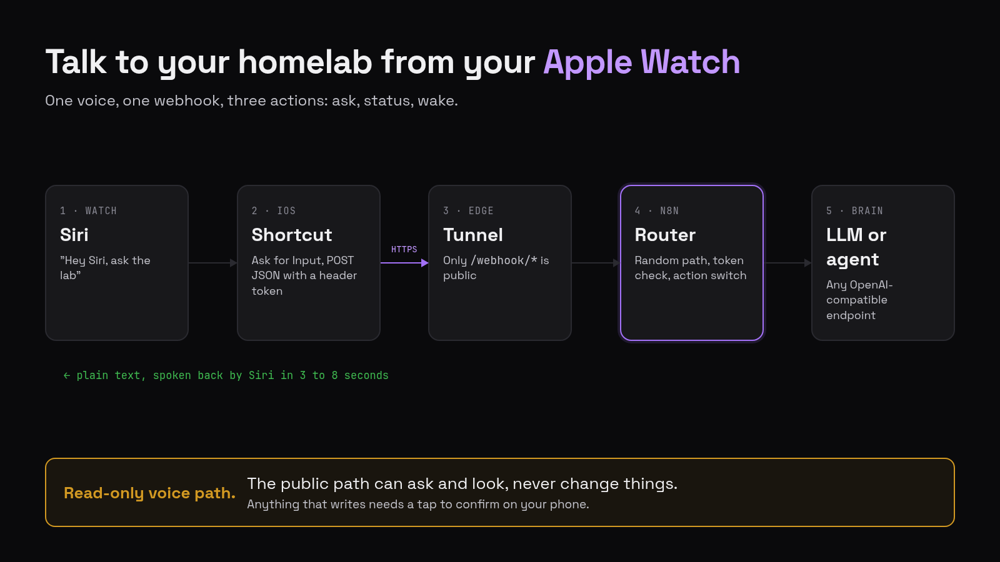
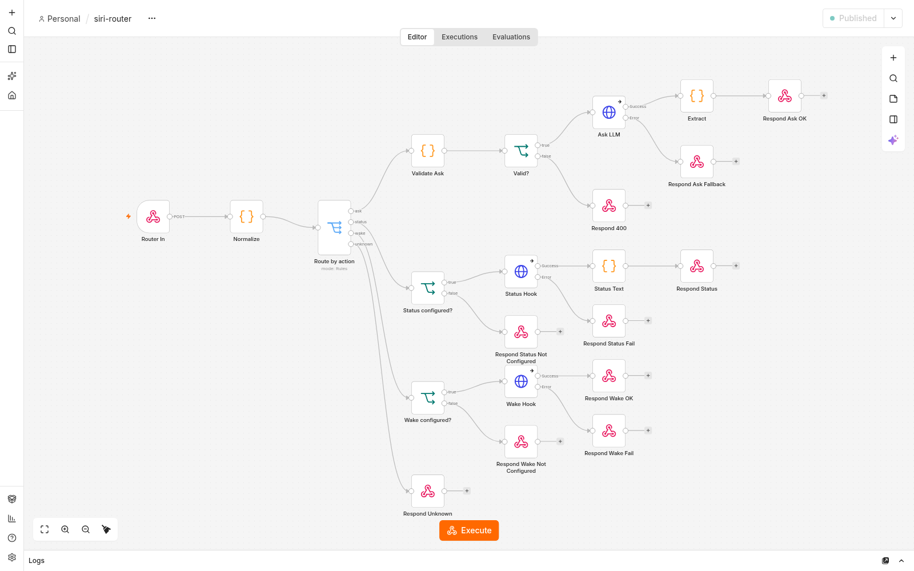
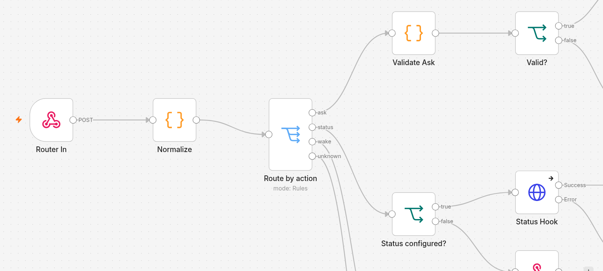

<p align="center">
  
</p>

<h3 align="center">A voice assistant for your home lab, built so it can look at everything but cannot change anything on its own.</h3>

<p align="center">
  <a href="LICENSE"></a>
  
  
  
</p>

<p align="center">
  <a href="#quick-start">Quick start</a> &middot;
  <a href="modules/siri-voice-bridge/README.md#architecture">How it works</a> &middot;
  <a href="SECURITY.md">Security</a> &middot;
  <a href="modules/siri-voice-bridge/README.md#troubleshooting">Troubleshooting</a>
</p>

# homelab-ai-assistant

Small modules for talking to a home lab: voice, documents and safe actions. You can install them one at a time. They share one rule: the assistant can look at everything, and anything that changes something needs a human tap.

<!-- demo: a real Apple Watch recording goes here (docs/demo.gif) -->

<table>
  <tr>
    <td width="50%"></td>
    <td width="50%"></td>
  </tr>
</table>

## Modules

| Module | What it does | Status |
|--------|--------------|--------|
| [`siri-voice-bridge`](modules/siri-voice-bridge/README.md) | Ask your lab a question, check its status or wake a machine from an Apple Watch or iPhone, through one n8n webhook. | Available |
| `telegram-confirm` | A confirmation step for actions that change things: the assistant proposes, you tap approve on Telegram. | Planned |
| `docs-rag` | Ask questions about your own documents with a local model, so nothing leaves the house. | Planned |
| `pricewatch` | Watch product prices and get a message when one drops. | Planned |

## Quick start

```bash
cd modules/siri-voice-bridge
cp .env.example .env     # chmod 600 .env, then fill the three secrets (see the module README)
docker compose up -d
scripts/import.sh && scripts/test.sh
```

## Principles

- Self-hosted first: n8n plus any OpenAI-compatible endpoint, local or cloud.
- The only thing exposed to the internet is one authenticated path, never an admin UI.
- Voice and chat paths are read-only by default.
- No secrets in the repository. Configuration lives in `.env`, and only `.env.example` is committed.

## Security

[SECURITY.md](SECURITY.md) explains how the modules are meant to be exposed and how to report a problem.

## Contributing

See [CONTRIBUTING.md](CONTRIBUTING.md).

## License

[MIT](LICENSE).

Apple, Siri, Apple Watch, n8n, Cloudflare and Tailscale are trademarks of their respective owners. This project is not affiliated with any of them. n8n is distributed under its own [Sustainable Use License](https://github.com/n8n-io/n8n/blob/master/LICENSE.md).
