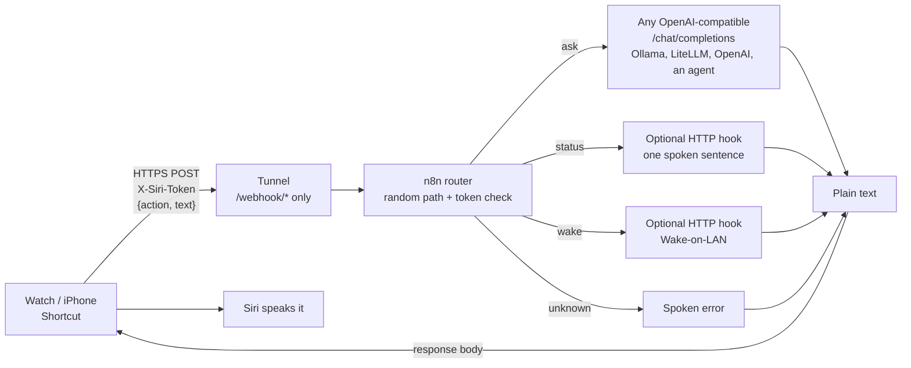

<p align="center">
  
</p>

<h3 align="center">Ask your home lab a question from your wrist, and have Siri read the answer back.</h3>

<p align="center">
  <a href="../../LICENSE"></a>
  
  
  
</p>

<p align="center">
  <a href="#quick-start">Quick start</a> &middot;
  <a href="#architecture">How it works</a> &middot;
  <a href="#security-notes">Security</a> &middot;
  <a href="#troubleshooting">Troubleshooting</a>
</p>

# siri-voice-bridge

You say a sentence on an Apple Watch or iPhone. An n8n workflow sends it to any OpenAI-compatible model, and Siri speaks the answer. The same webhook can also read out your lab's status or wake a machine.

Shortcuts can call a URL, but a raw URL with a secret in it makes a poor public endpoint, and each new voice command tends to become its own half-secured workflow. This module has one router webhook with a header token, a random path and a switch on `action`. Adding a voice command means adding a Shortcut, not opening another public door.

<p align="center">
  
</p>

<table>
  <tr>
    <td width="50%"></td>
    <td width="50%"></td>
  </tr>
  <tr>
    <td align="center"><sub>The whole router on the n8n canvas</sub></td>
    <td align="center"><sub>Entry, normalize, route by action</sub></td>
  </tr>
</table>

## Features

- One router webhook with a random path and a header token, instead of one half-secured workflow per command.
- `ask` sends your sentence to any OpenAI-compatible chat endpoint (Ollama, LiteLLM, OpenAI, an agent API) and speaks the reply.
- `status` and `wake` are optional hooks: one spoken sentence about your services, or a Wake-on-LAN packet.
- Errors come back as plain spoken sentences with HTTP 200, never JSON or stack traces.
- A session id rolls over after 15 minutes of silence, so short follow-up questions work.
- Secrets sit in n8n credentials and n8n keeps no execution history, so the token and your questions are not stored.
- The n8n image is pinned by tag and digest, the editor listens on `127.0.0.1`, and import and tests are scripted.

## Architecture



The workflow replies with plain text and HTTP 200, which is what the Shortcuts "Speak Text" action wants.

## Repository layout

```text
siri-voice-bridge/
  docker-compose.yml     n8n, pinned by digest, bound to 127.0.0.1
  .env.example           every setting, with how to generate the secrets
  n8n/siri-router.json   the router workflow (import.sh fills in the path)
  scripts/import.sh      imports the workflow, creates credentials, publishes it
  scripts/test.sh        smoke tests: auth, validation, a real model answer
  examples/              optional systemd hooks for status and Wake-on-LAN
  shortcut/              how to build the Shortcuts by hand
  docs/                  images and the sources they are rendered from
```

## Requirements

- Docker with the Compose plugin (Linux, macOS, or Windows with WSL).
- `bash`, `curl`, `python3` and `openssl` on the machine that runs the scripts.
- An OpenAI-compatible endpoint. The default is Ollama on the same machine, and `ollama pull llama3.1:8b` is the free way to try it.
- On the phone: the Shortcuts app, and a way to reach the webhook (a tunnel or a VPN).
- For the optional hooks: Linux with systemd, and root.

## Quick start

```bash
git clone https://github.com/SaskullOps/homelab-ai-assistant.git
cd homelab-ai-assistant/modules/siri-voice-bridge

cp .env.example .env
chmod 600 .env          # it holds your secrets
# Fill the three secrets (or edit .env by hand):
sed -i "s/^N8N_ENCRYPTION_KEY=.*/N8N_ENCRYPTION_KEY=$(openssl rand -hex 24)/" .env
sed -i "s/^SIRI_ROUTER_PATH=.*/SIRI_ROUTER_PATH=$(openssl rand -hex 12)/"     .env
sed -i "s/^SIRI_TOKEN=.*/SIRI_TOKEN=$(openssl rand -hex 24)/"                 .env

docker compose up -d
```

Once the stack is up, open `http://127.0.0.1:5678` and create the n8n owner account right away, before anyone else can claim it. The editor only listens on `127.0.0.1`.

```bash
scripts/import.sh     # imports the workflow, creates credentials, publishes it
scripts/test.sh       # 403 without token, 400 on empty text, a real answer from your model
```

`test.sh` ends with a line like `PASS  ask returns text (200): The capital of France is Paris.` If every line says PASS, the bridge works locally. On macOS, replace `sed -i` with `sed -i ''`.

`import.sh` prints the URL it registered: `http://127.0.0.1:5678/webhook/<your random path>`. n8n listens on `127.0.0.1` only. To reach it from your phone, expose only that webhook path (see [Exposing it safely](#exposing-it-safely)).

To look at the workflow, sign in to the n8n editor with the owner account and open `siri-router`.

## Shortcut setup

You need one Shortcut per action. The full walkthrough is in [`shortcut/README.md`](shortcut/README.md). For the "ask" Shortcut:

1. **Dictate Text** if you launch it with a tap, or **Ask for Input** (Text) if you launch it with "Hey Siri"
2. **Get Contents of URL**: your webhook URL, Method `POST`, header `X-Siri-Token` set to your token, Request Body `JSON` with `action` = `ask` and `text` = the variable from step 1 (Dictated Text or Provided Input).
3. **Speak Text** with the Contents of URL.
4. In the Shortcut settings, turn on **Show on Apple Watch**.

For "status" and "wake", duplicate it, delete step 1 and set `action` to `status` or `wake`.

## Exposing it safely

Never expose the n8n editor. Your phone only needs the webhook path.

- **Cloudflare Tunnel** works on mobile data and needs no open ports. Route a hostname to n8n and add a path rule so only `/webhook/*` is forwarded and everything else, the editor included, answers 404. Example `config.yml` ingress:

  ```yaml
  ingress:
    - hostname: voice.example.com
      path: ^/webhook/.*
      service: http://localhost:5678
    - service: http_status:404
  ```
  Check it before you rely on it: `curl -s -o /dev/null -w '%{http_code}\n' https://voice.example.com/` must print `404` (or `403`), never an n8n page.
- **Tailscale** (or any VPN) keeps n8n private and lets the phone reach it over the tailnet. It is the simplest and strongest option, but the phone has to be connected.

Two things protect the workflow: the unguessable path, and the `X-Siri-Token` header, which n8n checks before any node runs. A wrong or missing token gets a 403 and costs nothing.

## Configuration reference

All values live in `.env` (see [`.env.example`](.env.example)).

| Variable | Required | Meaning |
|----------|----------|---------|
| `N8N_PORT` | no | Host port on `127.0.0.1`, default `5678`. |
| `N8N_ENCRYPTION_KEY` | yes | Encrypts stored credentials. Keep it, because changing it breaks them. |
| `SIRI_ROUTER_PATH` | yes | Random webhook path, 16+ chars of `A-Za-z0-9_-`. |
| `SIRI_TOKEN` | yes | Shared secret for the `X-Siri-Token` header. |
| `LLM_BASE_URL` | yes | OpenAI-compatible base URL, ending in `/v1`. |
| `LLM_MODEL` | yes | Model name sent in the request. |
| `LLM_API_KEY` | no | Bearer token for the endpoint (`none` for Ollama). Stored as an n8n credential by `import.sh`, never exposed to workflow expressions. |
| `LLM_SYSTEM_PROMPT` | no | Replaces the default "short spoken answer" prompt, for example to force a language. |
| `STATUS_URL` | no | GET returns one sentence. Empty: "not configured". |
| `WAKE_URL` | no | GET sends a Wake-on-LAN packet. Empty: "not configured". |

n8n runs with `EXECUTIONS_DATA_SAVE_ON_SUCCESS=none`, `EXECUTIONS_DATA_SAVE_ON_ERROR=none`, `EXECUTIONS_DATA_SAVE_MANUAL_EXECUTIONS=false` and `EXECUTIONS_DATA_PRUNE=false` (all in `docker-compose.yml`). A stored execution would contain the `X-Siri-Token` header and every question you asked. Pruning is off on purpose: when it is on, n8n only soft-deletes an unsaved execution and its row, headers included, stays in the database until a later hard-delete pass. With it off the row is deleted right away; I checked this by running the tests and finding zero rows in `execution_entity` and `execution_data`.

To debug a failing run, set `EXECUTIONS_DATA_SAVE_ON_ERROR: all`, reproduce the failure, then set it back and delete the executions in the editor.

`N8N_BLOCK_ENV_ACCESS_IN_NODE` is `false` because the workflow reads `$env.LLM_*`, `STATUS_URL` and `WAKE_URL`. Those values are not secret. The side effect is that code written in the editor can read `N8N_ENCRYPTION_KEY`, so the editor has to stay private.

Request contract: `POST /webhook/<path>` with header `X-Siri-Token` and JSON `{"action": "ask|status|wake", "text": "..."}`. A missing `action` means `ask`; `text` is only used by `ask` (1 to 1000 characters). The `user` field of the model request carries a conversation id that rolls over after 15 minutes of silence, so endpoints that keep sessions (agents) can follow a short conversation.

The spoken messages are plain strings in the workflow's Respond nodes. Edit them in n8n to change the language.

Optional hooks for `status` and `wake` are in [`examples/`](examples/README.md).

## Troubleshooting

These are the errors I hit while building it.

| Symptom | Cause and fix |
|---------|---------------|
| Shortcut says "invalid URL" | You pasted only the base URL. It must be the full `https://<host>/webhook/<path>`. |
| "The network connection was lost" | The token was pasted with a trailing newline or space. Re-type it, or paste into a plain text field first. `import.sh` strips whitespace on the server side, but the Shortcut side is up to you. |
| Siri opens a contact or says it cannot find a person | A phrase like "ask <name>" is parsed as a contact. Name the Shortcut something that is not a first name, for example "Ask the lab". |
| "Hey Siri, <shortcut>" opens the Shortcuts app instead of listening | The Shortcut starts with Dictate Text. For voice launches use **Ask for Input** (Text); keep Dictate Text if you launch it with a tap. |
| The agent answers from memory and never uses a tool | An agent behind the endpoint decides whether to call tools. Tell it to in `LLM_SYSTEM_PROMPT` or in the question ("check ..."), and make sure the tools are enabled for that API. |
| `test.sh` ask times out and the fallback sentence is spoken | The n8n container cannot reach the model. From Linux with `ufw`, Docker traffic to the host is blocked by default: `sudo ufw allow from <compose subnet> to <bridge ip> port 11434 proto tcp` (read the subnet with `docker network inspect siri-voice-bridge_default -f '{{(index .IPAM.Config 0).Subnet}}'`). Ollama must also listen on an address the container can reach: bind it to the Docker bridge address (`OLLAMA_HOST=<bridge ip>:11434`, see `docker network inspect bridge`) rather than `0.0.0.0`. **Never set `OLLAMA_HOST=0.0.0.0` on a machine reachable from your LAN or the internet**: Ollama has no authentication, so anyone who can reach the port can use your models and your GPU. If you do bind more widely, restrict the port with a firewall rule. Check with `docker compose exec n8n wget -qO- http://host.docker.internal:11434/api/version`. |
| Webhook returns 404 right after import | n8n registers the webhook on restart. `import.sh` waits for it; if you imported by hand, run `docker compose restart n8n`. |
| 403 "Authorization data is wrong" | Wrong or missing `X-Siri-Token`. This is the correct answer to anyone without the token. |

## Measured numbers

These are from my own setup (a small cloud model behind an agent API, Apple Watch on mobile data). They are not a benchmark.

- A voice round trip takes about 3 to 8 seconds once a conversation is warm. The first question of a session took about 18 seconds for me, with three model calls.
- The first question of a session cost about 0.24 cents, and follow-ups about 0.06 cents, thanks to prompt caching.
- A local 8B model through Ollama is free. Speed depends on your GPU, and the first call after idle includes model load time.

## Limitations

- Answers are plain text read aloud, so there are no tables, links or images.
- Shortcuts waits about a minute for a response. The model call is cut off at 50 seconds and a spoken fallback is returned.
- `ask` has no tools of its own. Whatever the endpoint can do is what your voice can do, so read the security notes before pointing it at an agent.
- There is one shared token, no per-user accounts and no rate limiting.
- Apple Shortcuts cannot be scripted from outside the Apple ecosystem, so the Shortcut has to be built by hand (see the guide).

## Security notes

- Auth is the random path plus a header token, checked by n8n's header auth before the workflow runs. Use long random values for both and keep them in a password manager.
- Keep the voice path read-only. Do not give the model behind a public webhook tools that delete, send, pay or run commands. Voice gets misheard, and the token lives on a phone.
- A stolen token gives whoever holds it everything the configured LLM endpoint's tools can do, and the text they send reaches the model unfiltered, prompt injection included. Point the voice path at a read-only model or agent.
- Rate limiting is a sensible next step: a WAF rule in front of the tunnel, or a counter in the workflow static data.
- The n8n port is bound to `127.0.0.1`. Do not change that to `0.0.0.0` unless something else protects it.
- n8n keeps no execution data, because it would hold the token and your questions. `N8N_ENCRYPTION_KEY` is readable by code nodes because `$env` access is on, so keep the editor private and give the owner account a strong password.
- Create the n8n owner account right after `docker compose up`, and keep `.env` at mode `600`.
- The hooks listen on the Docker bridge only, but they have no authentication. Any local process or container that can reach that address can trigger them, and the socket's trigger limit can be used to make it refuse connections (a local denial of service). Narrow the firewall rule to the compose subnet, as described in [`examples/README.md`](examples/README.md).
- Actions that write will get a confirmation step: the voice asks, a message with a button arrives on your phone, and nothing happens until you tap it. That is the planned [`telegram-confirm`](../../README.md#modules) module.

See also the repository [security policy](../../SECURITY.md).

## License

[MIT](../../LICENSE). n8n is distributed under the [Sustainable Use License](https://github.com/n8n-io/n8n/blob/master/LICENSE.md). It allows self-hosting for your own use, so read it before offering this setup as a service to other people.

Apple, Siri, Apple Watch and Shortcuts are trademarks of Apple Inc. n8n is a trademark of n8n GmbH, Cloudflare of Cloudflare, Inc., and Tailscale of Tailscale Inc. This project is not affiliated with, endorsed by or sponsored by any of them.
