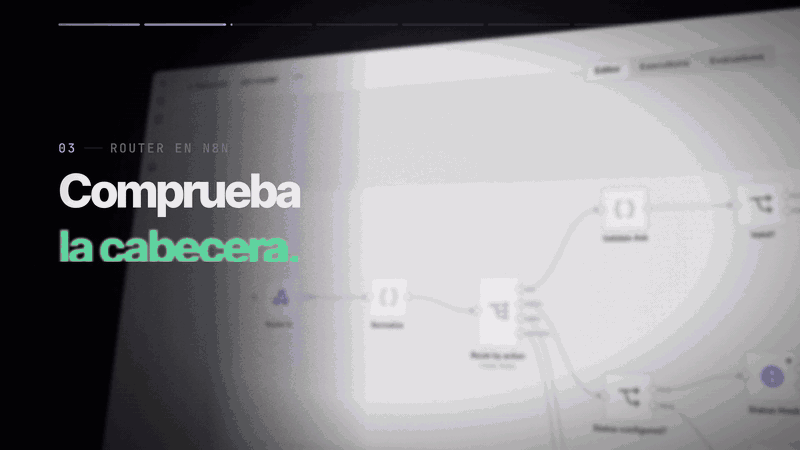
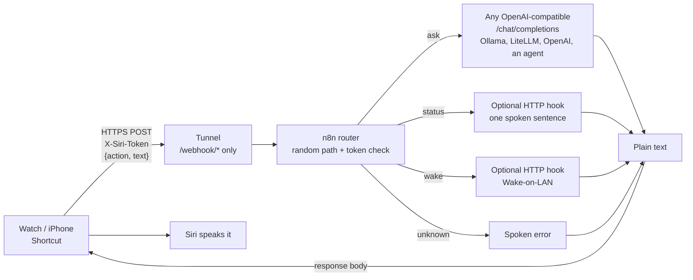

# siri-voice-bridge

Talk to your home lab from an Apple Watch or iPhone. Say a sentence, an n8n workflow sends it to any OpenAI-compatible model, and Siri speaks the answer. The same webhook can also report your lab's status or wake a machine.

Shortcuts can call a URL, but a raw URL with a secret in it is a bad public endpoint, and each action usually ends up as a separate half-secured workflow. This module gives you one router webhook with a header token, a random path and a switch on `action`, so adding a voice command is adding a Shortcut, not a new public door.


<!-- Demo slot: replace with a real recording, see docs/README.md -->


## How it works



The workflow answers with plain text and an HTTP 200, which is what Shortcuts' "Speak Text" wants. Failures are also spoken sentences, never JSON or stack traces.

## Quickstart (under 10 minutes)

You need Docker with the Compose plugin, `curl`, `python3`, `openssl`, and an OpenAI-compatible endpoint. The default points at Ollama on the same machine, so `ollama pull llama3.1:8b` is the free way to try it.

```bash
git clone https://github.com/SaskullOps/homelab-ai-assistant.git
cd homelab-ai-assistant/modules/siri-voice-bridge

cp .env.example .env
# Fill the three secrets (or edit .env by hand):
sed -i "s/^N8N_ENCRYPTION_KEY=.*/N8N_ENCRYPTION_KEY=$(openssl rand -hex 24)/" .env
sed -i "s/^SIRI_ROUTER_PATH=.*/SIRI_ROUTER_PATH=$(openssl rand -hex 12)/"     .env
sed -i "s/^SIRI_TOKEN=.*/SIRI_TOKEN=$(openssl rand -hex 24)/"                 .env

docker compose up -d
scripts/import.sh     # imports the workflow, creates credentials, publishes it
scripts/test.sh       # 403 without token, 400 on empty text, a real answer from your model
```

`test.sh` ends with a line like `PASS  ask returns text (200): The capital of France is Paris.` If every line says PASS, the bridge works locally. On macOS, replace `sed -i` with `sed -i ''`.

`import.sh` prints the URL it registered: `http://127.0.0.1:5678/webhook/<your random path>`. n8n listens on `127.0.0.1` only. To use it from your phone, expose just that webhook path (see [Exposing it safely](#exposing-it-safely)).

You do not need to open the n8n editor. If you want to look at the workflow, open `http://127.0.0.1:5678`, create the local owner account and open `siri-router`.


## Shortcut setup

One Shortcut per action. Full walkthrough with screenshots in [`shortcut/README.md`](shortcut/README.md). In short, for the "ask" Shortcut:

1. **Ask for Input** (Text), prompt "What do you want to ask?"
2. **Get Contents of URL**: your webhook URL, Method `POST`, Headers `X-Siri-Token` = your token, Request Body `JSON` with `action` = `ask` and `text` = the Provided Input.
3. **Speak Text** with the Contents of URL.
4. Settings: **Show on Apple Watch**.

For "status" and "wake", duplicate it, remove step 1 and set `action` to `status` or `wake`.

## Exposing it safely

Never expose the n8n editor. Only the webhook path has to be reachable from your phone.

- **Cloudflare Tunnel** (works on mobile data, no open ports): route a hostname to n8n and add a path rule so only `/webhook/*` is forwarded; everything else, including the editor, answers 404. Example `config.yml` ingress:

  ```yaml
  ingress:
    - hostname: voice.example.com
      path: ^/webhook/.*
      service: http://localhost:5678
    - service: http_status:404
  ```
- **Tailscale** (or any VPN): keep n8n private and let the phone reach it over the tailnet. Simplest and strongest, but the phone must be connected.

The workflow is protected twice: the unguessable path and the `X-Siri-Token` header, checked by n8n before any node runs. A wrong or missing token returns 403 and costs nothing.

## Configuration reference

All values live in `.env` (see [`.env.example`](.env.example)).

| Variable | Required | Meaning |
|----------|----------|---------|
| `N8N_PORT` | no | Host port on `127.0.0.1`, default `5678`. |
| `N8N_ENCRYPTION_KEY` | yes | Encrypts stored credentials. Keep it; changing it breaks them. |
| `SIRI_ROUTER_PATH` | yes | Random webhook path, 16+ chars of `A-Za-z0-9_-`. |
| `SIRI_TOKEN` | yes | Shared secret for the `X-Siri-Token` header. |
| `LLM_BASE_URL` | yes | OpenAI-compatible base URL, ending in `/v1`. |
| `LLM_MODEL` | yes | Model name sent in the request. |
| `LLM_API_KEY` | no | Bearer token for the endpoint (`none` for Ollama). |
| `LLM_SYSTEM_PROMPT` | no | Replaces the default "short spoken answer" prompt, for example to force a language. |
| `STATUS_URL` | no | GET returns one sentence. Empty: "not configured". |
| `WAKE_URL` | no | GET sends a Wake-on-LAN packet. Empty: "not configured". |

Request contract: `POST /webhook/<path>` with header `X-Siri-Token` and JSON `{"action": "ask|status|wake", "text": "..."}`. A missing `action` means `ask`; `text` is only used by `ask` (1 to 1000 characters). The `user` field of the model request carries a conversation id that rolls over after 15 minutes of silence, so endpoints that keep sessions (agents) can follow a short conversation.

Spoken messages are plain strings in the workflow's Respond nodes. Edit them in n8n if you want another language.

Optional hooks for `status` and `wake` are in [`examples/`](examples/README.md).

## Troubleshooting

These are the real errors hit while building it.

| Symptom | Cause and fix |
|---------|---------------|
| Shortcut says "invalid URL" | You pasted only the base URL. It must be the full `https://<host>/webhook/<path>`. |
| "The network connection was lost" | The token was pasted with a trailing newline or space. Re-type it, or paste into a plain text field first. `import.sh` strips whitespace on the server side, the Shortcut side is on you. |
| Siri opens a contact or says it cannot find a person | A phrase like "ask <name>" is parsed as a contact. Name the Shortcut something that is not a first name, for example "Ask the lab". |
| "Dictate Text" opens the Shortcuts app instead of listening on the Watch | Use **Ask for Input** (Text) instead. It works hands-free on the Watch. |
| The agent answers from memory and never uses a tool | An agent behind the endpoint decides whether to call tools. Say so in `LLM_SYSTEM_PROMPT` or the question ("check ..."), and make sure the tools are enabled for that API. |
| `test.sh` ask times out and the fallback sentence is spoken | The n8n container cannot reach the model. From Linux with `ufw`, Docker traffic to the host is blocked by default: `sudo ufw allow from 172.16.0.0/12 to any port 11434 proto tcp`. Also make sure Ollama listens on more than loopback (`OLLAMA_HOST=0.0.0.0`). Check with `docker compose exec n8n wget -qO- http://host.docker.internal:11434/api/version`. |
| Webhook returns 404 right after import | n8n registers the webhook on restart. `import.sh` waits for it; if you imported by hand, run `docker compose restart n8n`. |
| 403 "Authorization data is wrong" | Wrong or missing `X-Siri-Token`. This is the correct answer to anyone without the token. |

## Measured numbers

Measured on my setup (a small cloud model behind an agent API, Apple Watch over mobile data), not a benchmark:

- Voice round trip: about 3 to 8 seconds once a conversation is warm. The first question of a session is slower (about 18 seconds in my case, three model calls).
- Cost: about 0.24 cents for the first question of a session and about 0.06 cents for follow-ups, thanks to prompt caching.
- A local 8B model through Ollama is free; speed depends on your GPU, and the first call after idle includes model load time.

## Limitations

- Answers are plain text read aloud, so no tables, links or images.
- Shortcuts waits roughly a minute for a response. The model call is cut off at 50 seconds and a spoken fallback is returned.
- `ask` has no tools of its own: whatever the endpoint can do is what the voice can do. See the security notes before pointing it at an agent.
- One shared token, no per-user accounts and no rate limiting out of the box.
- Apple Shortcuts is not scriptable from outside the Apple ecosystem; the Shortcut has to be built by hand (see the guide).

## Security notes

- Auth is the random path plus a header token, checked by n8n's header-auth before the workflow runs. Use a long random value for both and keep them in a password manager.
- Keep the voice path read-only. Do not give the model behind a public webhook tools that delete, send, pay or run commands. Voice can be misheard, and the token lives on a phone.
- Rate limiting is a good next step: put the tunnel behind a WAF rule, or add a counter in the workflow static data.
- The n8n port is bound to `127.0.0.1`. Do not change that to `0.0.0.0` unless something else is protecting it.
- Hooks listen on the Docker bridge only and take no input.
- For actions that must write, the plan is a confirmation step: the voice asks, a message with a button arrives on your phone, and nothing happens until you tap. That is the upcoming [`telegram-confirm`](../../README.md#modules) module.

See also the repository [security policy](../../SECURITY.md).
