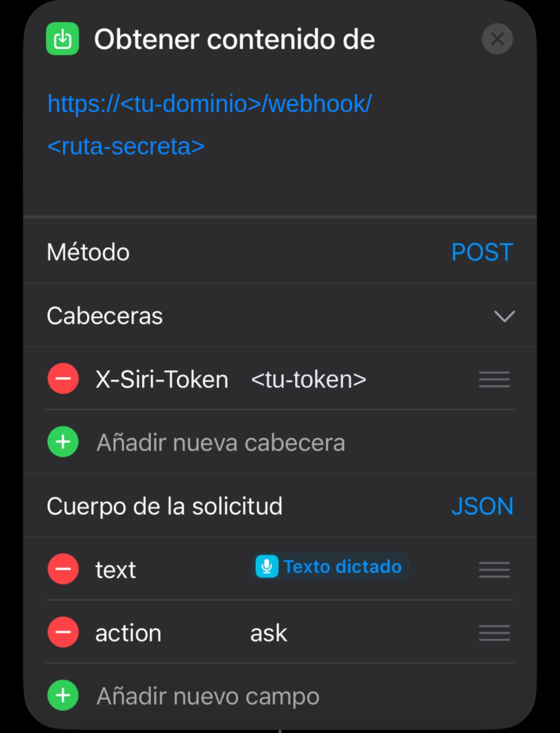
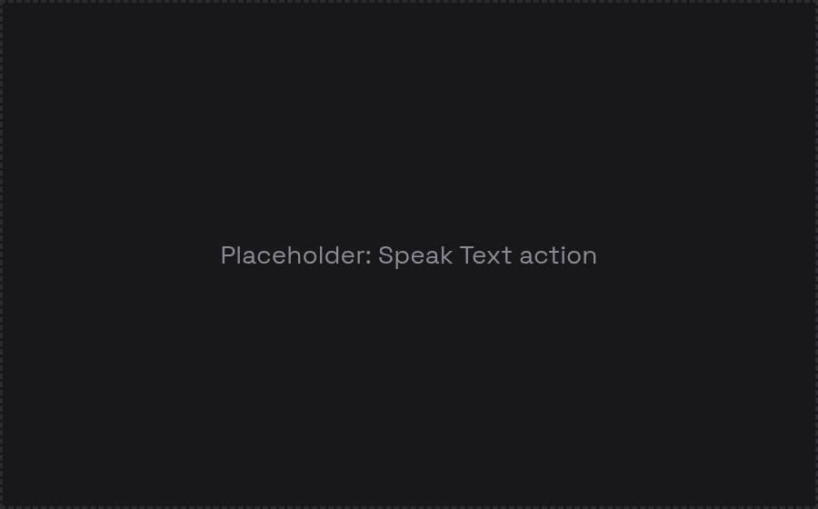

# Building the Shortcut

You need the Shortcuts app on an iPhone (and, for the Watch, the same iCloud account). Have these two values ready, ideally from a password manager so you can copy rather than type:

- the full webhook URL printed by `scripts/import.sh`: `https://<your host>/webhook/<random path>`
- the token from `.env` (`SIRI_TOKEN`)

Build "ask" first, test it, then duplicate it for the other actions.

## Ask

1. New Shortcut. Name it something that is **not a first name**, for example `Ask the lab`. Siri treats "ask <name>" as a contact.
2. Add the action that captures your question. Pick it by how you will launch the Shortcut:

   | You launch it by | Use | Why |
   |---|---|---|
   | Tapping it on the Watch or the phone | **Dictate Text** | It starts listening right away. This is what I use. |
   | Voice ("Hey Siri, Ask the lab") | **Ask for Input** (type Text, prompt `What do you want to ask?`) | Siri asks the question out loud and you answer without leaving Siri. With Dictate Text, a voice launch sometimes opened the Shortcuts app instead. |
3. Add **Get Contents of URL**.
   - URL: the full webhook URL (not just the host).
   - Expand **Show More**. Method: `POST`.
   - Headers: add `X-Siri-Token` with your token as the value.
   - Request Body: `JSON`. Add a Text field `action` with value `ask`, and a Text field `text` whose value is the variable from step 2 (**Dictated Text** or **Provided Input**).
   
4. Add **Speak Text** and choose **Contents of URL** as its input.
   
5. Open the Shortcut details (the `i` button) and enable **Show on Apple Watch**.
   

Run it from the phone first. Then say "Hey Siri, Ask the lab" or tap it on the Watch.

## Status and wake

Duplicate the Shortcut, delete the step 2 action, and change the JSON body to only `action` = `status` (name it `Lab status`) or `action` = `wake` (name it `Wake the PC`). No `text` is needed.

## Tips

- One Shortcut per action keeps each voice phrase short and unambiguous.
- Paste the token, do not type it, and check there is no trailing space or line break. A stray newline gives "The network connection was lost".
- If Siri asks "which one?", rename the Shortcut so it is not close to a contact or app name.
- The first call after a pause can take longer. The workflow answers within about a minute at most, with a spoken fallback on failure.
